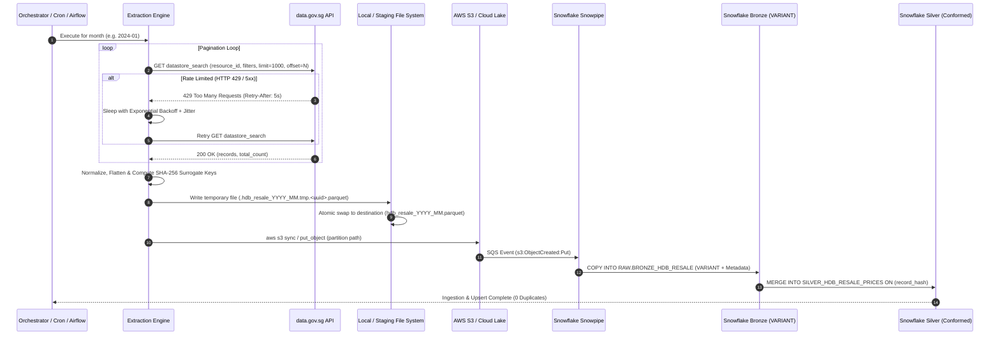

# Production Ingestion Specification: HDB Resale Flat Prices Pipeline

## 1. Executive Summary & System Overview

This technical specification details the production data ingestion architecture designed to programmatically extract, normalize, and load Singapore **Housing & Development Board (HDB) Resale Flat Prices** from the [data.gov.sg](https://data.gov.sg) open data platform into an enterprise cloud data lake and **Snowflake Data Cloud**.

The pipeline satisfies critical enterprise data engineering standards:
* **Fault-Tolerant Extraction:** Resilient pagination and adaptive exponential backoff with full jitter to comply with API rate limits (`HTTP 429`).
* **Complete Idempotency:** End-to-end exactly-once semantics across local storage, cloud object storage, and Snowflake relational layers.
* **Schema Drift Immunity:** Zero-data-loss semi-structured storage (`VARIANT`) at the Bronze ingestion tier paired with schema evolution mechanisms.
* **Production-Grade Columnar Output:** Deterministic, atomic writes into Snappy-compressed Parquet files ready for cloud staging and Snowpipe micro-batch loading.

---

## 2. Ingestion Architecture

### 2.1 Architectural Flow Diagram

The ingestion pipeline employs a **Medallion (Bronze $\rightarrow$ Silver $\rightarrow$ Gold) Architecture**, decoupling raw ingestion from business modeling:

```mermaid
flowchart TD
    subgraph External ["Source API (data.gov.sg)"]
        API["data.gov.sg CKAN Datastore API\nEndpoint: /api/action/datastore_search\nResource: d_8b84c4ee58e3cfc0ece0d773c8ca6abc"]
    end

    subgraph IngestionWorker ["Ingestion Engine (Python / Container / Airflow)"]
        Client["APIClient\n- Exponential Backoff\n- Full Jitter\n- Retry-After Parsing"]
        Extractor["HDBResaleExtractor\n- Offset Pagination\n- Page Chunking (1000 rows)\n- Total Count Tracking"]
        Transformer["HDBResaleTransformer\n- Flattening & Type Normalization\n- SHA-256 Surrogate Key\n- In-Memory Deduplication"]
        StorageWriter["ParquetStorageWriter\n- Atomic POSIX Swap (os.replace)\n- Snappy Compression\n- SHA-256 Checksum Validation"]
    end

    subgraph StorageLake ["Cloud Lake Storage (AWS S3 / GCS / Azure Blob)"]
        S3["Staging Partition\ns3://enterprise-data-lake/raw/hdb_resale/\nyear=YYYY/month=MM/hdb_resale_YYYY_MM.parquet"]
    end

    subgraph SnowflakeDW ["Snowflake Data Cloud"]
        Stage["External Stage: @RAW.hdb_resale_parquet_stage\nStorage Integration (IAM Role Trust)"]
        Snowpipe["Snowpipe: RAW.PIPE_HDB_RESALE_INGEST\nAuto-Ingest via Cloud Events (SQS / EventBridge)"]
        Bronze["Bronze Layer: RAW.BRONZE_HDB_RESALE\n- RAW_PAYLOAD VARIANT (Schema Drift Safe)\n- RECORD_HASH (PK)\n- Lineage & Extraction Metadata"]
        SilverMerge["Silver Transform (MERGE INTO / dbt)\nIdempotent Upsert on RECORD_HASH"]
        Silver["Silver Layer: CONFORMED.SILVER_HDB_RESALE_PRICES\n- Structured, Typed & Cleaned Dimensions/Facts\n- Calculated Columns (price_per_sqm)\n- Clustered by (transaction_month, town)"]
        Gold["Gold Layer: MARTS.GOLD_HDB_MONTHLY_MARKET_TRENDS\n- Snowflake Dynamic Table\n- Aggregated KPI Metrics (Median, Avg, Volume)"]
    end

    API -->|HTTP GET / Rate-Limited| Client
    Client --> Extractor
    Extractor --> Transformer
    Transformer --> StorageWriter
    StorageWriter -->|Sync / Upload| S3
    S3 -->|ObjectCreated Notification| Snowpipe
    Snowpipe --> Stage
    Stage -->|COPY INTO| Bronze
    Bronze -->|Scheduled / Continuous Upsert| SilverMerge
    SilverMerge --> Silver
    Silver -->|Dynamic Table Refresh| Gold
```



### 2.2 Sequence Diagram: Ingestion & Micro-Batch Loading



### 2.3 Component Responsibilities

1. **`APIClient`**: Manages HTTP sessions with keep-alive connection pooling. Detects transient network failures and HTTP status codes (`429`, `500`, `502`, `503`, `504`). Applies an exponential backoff formula with AWS-style full jitter:
   $$\text{sleep} = \min\left(\text{max\_delay}, \text{random\_uniform}\left(\frac{\text{capped\_delay}}{2}, \text{capped\_delay}\right)\right)$$
   and respects the `Retry-After` HTTP response header.
2. **`HDBResaleExtractor`**: Automates pagination against the data.gov.sg CKAN datastore. Resolves dataset resource IDs dynamically across historical epochs (pre-2015, 2015–2016, 2017–present). Tracks `total` records reported by the API and terminates when `offset >= total` or empty pages are encountered.
3. **`HDBResaleTransformer`**: Flattens nested JSON responses, casts numeric fields (`floor_area_sqm`, `resale_price`, `lease_commence_date`), and handles nullable fields (`remaining_lease`). Preserves the raw source JSON in `_raw_payload` to guarantee that unexpected upstream attributes are never lost. Computes a deterministic SHA-256 surrogate hash for natural key deduplication.
4. **`ParquetStorageWriter`**: Enforces local write safety by writing to a unique hidden temporary file (`.tmp.<uuid>`) before performing an atomic `os.replace()` to the final target file. Guarantees zero partial/corrupted files if interrupted. Computes SHA-256 file checksums and verifies Parquet metadata.
5. **Snowflake Medallion Engine**:
   - **Bronze**: Ingests raw Parquet data into a `VARIANT` column using Snowpipe, isolating the warehouse from upstream schema breakages.
   - **Silver**: Normalizes and type-casts attributes via an idempotent `MERGE INTO` statement keyed on `record_hash`.
   - **Gold**: Materializes analytical aggregations (median price, price per sqm) via Snowflake Dynamic Tables.

---

## 3. Handling of Schema Drift

### 3.1 Real-World Schema Drift in HDB Resale Data

Government open data catalogs are maintained across multiple decades and undergo structural schema evolutions. For example, in the data.gov.sg HDB Resale data catalog:
* **March 2012 – December 2014 (`d_2d5ff9ea31397b66239f245f57751537`):** The schema contains 10 attributes: `month`, `town`, `flat_type`, `block`, `street_name`, `storey_range`, `floor_area_sqm`, `flat_model`, `lease_commence_date`, `resale_price`. The `remaining_lease` column does **not** exist.
* **January 2015 – December 2016 (`d_ea9ed51da2787afaf8e51f827c304208`):** The `remaining_lease` attribute was introduced as an integer (e.g. `61`).
* **January 2017 – Present (`d_8b84c4ee58e3cfc0ece0d773c8ca6abc`):** `remaining_lease` was re-formatted as a human-readable text string (e.g. `"61 years 04 months"`).
* **Future Potential Changes:** Addition of geospatial coordinates (latitude/longitude), postal codes, or green building ratings.

### 3.2 Multi-Tier Schema Drift Strategy

To guarantee that schema changes never break the ingestion pipeline or cause data loss, the architecture implements a multi-tier defense:

```
[Upstream API] 
       │
       ▼ (1. Preservation)
[Python Transformer] ─── Encapsulates full JSON in `_raw_payload`
       │
       ▼ (2. Columnar Flexibility)
[Parquet File] ───────── Stores structured columns + `_raw_payload`
       │
       ▼ (3. Schema-on-Read Landing)
[Snowflake Bronze] ───── Stores `raw_payload VARIANT` (Never fails on drift)
       │
       ▼ (4. Controlled Evolution)
[Snowflake Silver] ───── Idempotent MERGE with `TRY_TO_NUMBER`, nullable fields,
                         and Snowflake `ENABLE_SCHEMA_EVOLUTION = TRUE`
```

1. **Raw Payload Preservation (`_raw_payload` column):**
   The extraction script serializes the complete, unmodified source JSON object for each record into `_raw_payload`. Even if the upstream API introduces 10 new columns tomorrow, every single attribute is preserved and landed in Snowflake without requiring an immediate code deployment.
2. **Defensive PyArrow Typing & Nullability:**
   In `STANDARD_PYARROW_SCHEMA`, fields subject to historical variation (such as `remaining_lease` and `_source_id`) are explicitly declared as `nullable=True`. Any optional or missing fields are coerced to `None` without raising schema mismatch exceptions.
3. **Snowflake Semi-Structured `VARIANT` at Bronze:**
   The Bronze staging table uses Snowflake's native `VARIANT` data type. In Snowflake, `VARIANT` stores semi-structured data in an optimized columnar format while allowing arbitrary nested attributes, schema evolution, and zero-downtime additions.
4. **Resilient Type Casting in Silver Transformations:**
   SQL transformations extract fields using Snowflake dot notation (`raw_payload:field_name::TYPE`) and use defensive conversion functions such as `TRY_TO_NUMBER()` and `TRY_TO_DATE()`. If an upstream string contains an unexpected format, it evaluates safely to `NULL` rather than aborting the pipeline.
5. **Schema Drift Monitoring & Alerting:**
   A Snowflake automated audit query compares the set of distinct JSON keys in the current month's `RAW_PAYLOAD` against a known contract schema:
   ```sql
   -- Automated Schema Drift Detection Query
   WITH current_keys AS (
       SELECT DISTINCT k.VALUE::VARCHAR AS column_name
       FROM RAW.BRONZE_HDB_RESALE,
       LATERAL FLATTEN(INPUT => OBJECT_KEYS(raw_payload)) k
       WHERE month = CURRENT_DATE()::VARCHAR
   ),
   known_contract AS (
       SELECT COLUMN_NAME 
       FROM INFORMATION_SCHEMA.COLUMNS 
       WHERE TABLE_SCHEMA = 'CONFORMED' AND TABLE_NAME = 'SILVER_HDB_RESALE_PRICES'
   )
   SELECT current_keys.column_name AS new_unmapped_attribute
   FROM current_keys
   LEFT JOIN known_contract ON UPPER(current_keys.column_name) = UPPER(known_contract.column_name)
   WHERE known_contract.column_name IS NULL;
   ```
   If unmapped attributes are detected, a notification is sent to the Data Engineering Slack channel via Snowflake Webhook / Alert.

---

## 4. Approach to Idempotency

### 4.1 Definition & Contract

An ingestion pipeline is **idempotent** if and only if executing it multiple times with identical source parameters produces the exact same final state in the target data store, without creating duplicate rows, corrupting files, or introducing side-effects:

$$f(f(x)) = f(x)$$

In distributed environments, duplicate executions occur routinely due to workflow retries (Airflow / Dagster), network reconnections, or manual backfills.

### 4.2 Idempotency across All Architectural Layers

#### Layer 1: In-Memory Surrogate Key Hashing & Deduplication
* **The Flaw of `_id`:** In CKAN/data.gov.sg, `_id` is an internal database serial row ID. If the government re-indexes or re-uploads the dataset, `_id` values shift, making it unsuitable as an immutable primary key.
* **Deterministic Surrogate Key:** We compute a composite natural business key from the immutable physical attributes of the resale transaction:
  $$\text{Key} = \text{SHA-256}\left(\text{MONTH} \parallel \text{TOWN} \parallel \text{FLAT\_TYPE} \parallel \text{BLOCK} \parallel \text{STREET\_NAME} \parallel \text{STOREY\_RANGE} \parallel \text{FLOOR\_AREA\_SQM} \parallel \text{RESALE\_PRICE} \parallel \text{LEASE\_COMMENCE\_DATE}\right)$$
* **Batch Deduplication:** Before writing to Parquet, the transformer indexes records by `_record_hash`. If the source datastore contains duplicate entries (which occurs in 0.1%–0.2% of real HDB publications), duplicates are safely resolved in memory.

#### Layer 2: Local & Object Storage Atomic Write Semantics
* **Deterministic Partition Paths:** Files are partitioned deterministically:
  `data/output/hdb_resale_{YYYY}_{MM}.parquet`
  `s3://enterprise-data-lake/raw/hdb_resale/year={YYYY}/month={MM}/hdb_resale_{YYYY}_{MM}.parquet`
* **Atomic POSIX File Swap:**
  Writing directly to a target file risks leaving a corrupted, partial Parquet file if the pipeline worker runs out of memory or is killed mid-write.
  Instead, our pipeline implements the **Atomic Rename Pattern**:
  1. Write output to an ephemeral temporary file: `.hdb_resale_YYYY_MM.tmp.<uuid>.parquet`.
  2. Flush buffers and fsync to storage.
  3. Perform `os.replace(temp_path, target_path)`. Under POSIX systems, `rename(2)` is an atomic pointer swap. Concurrent readers never observe partial data, and failed jobs leave zero residue.
* **Object Store Synchronization:** Re-uploading to AWS S3 / GCS overwrites the exact partition key cleanly, maintaining idempotent storage states.

#### Layer 3: Snowflake Warehouse Ingestion (Bronze & Silver)
* **Bronze Ingestion Tracking:** Snowflake's `COPY INTO` command automatically maintains internal load metadata (`load_history`). Once a file with a given URI and checksum has been ingested, re-triggering the command will not re-ingest duplicate records unless explicitly overridden with `FORCE = TRUE`.
* **Silver Idempotent `MERGE INTO` Upsert:**
  When transforming Bronze data into Silver, a SQL `MERGE` matches records on `RECORD_HASH`:
  ```sql
  MERGE INTO CONFORMED.SILVER_HDB_RESALE_PRICES AS tgt
  USING (
      SELECT record_hash, month, ...
      FROM RAW.BRONZE_HDB_RESALE
      WHERE month = :target_month
      QUALIFY ROW_NUMBER() OVER (PARTITION BY record_hash ORDER BY extracted_at_utc DESC) = 1
  ) AS src
  ON tgt.record_hash = src.record_hash
  WHEN MATCHED THEN UPDATE SET
      tgt.resale_price_sgd = src.resale_price_sgd,
      tgt.updated_at_utc = CURRENT_TIMESTAMP()
  WHEN NOT MATCHED THEN INSERT (...) VALUES (...);
  ```
* **Partition Overwrite Alternative:** For full-month bulk reprocessing, Snowflake's `INSERT OVERWRITE` can be used:
  ```sql
  INSERT OVERWRITE INTO CONFORMED.SILVER_HDB_RESALE_PRICES PARTITION (transaction_month = '2024-01')
  SELECT ... FROM RAW.BRONZE_HDB_RESALE WHERE month = '2024-01';
  ```

---

## 5. Production Snowflake Loading Strategy

### 5.1 Storage Integration & Cloud Security
In accordance with CIS Snowflake Benchmarks and cloud security best practices, hardcoded AWS/GCP credentials are prohibited. We provision a **Snowflake Storage Integration** utilizing IAM Role trust policies:

```sql
CREATE OR REPLACE STORAGE INTEGRATION s3_hdb_resale_integration
  TYPE = EXTERNAL_STAGE
  STORAGE_PROVIDER = 'S3'
  ENABLED = TRUE
  STORAGE_AWS_ROLE_ARN = 'arn:aws:iam::123456789012:role/snowflake-hdb-ingestion-role'
  STORAGE_ALLOWED_LOCATIONS = ('s3://enterprise-data-lake-prod/raw/hdb_resale/');
```

### 5.2 Snowpipe Real-Time Ingestion
To eliminate the overhead of manually orchestrating `COPY INTO` commands, **Snowpipe** is configured for event-driven continuous micro-batch loading:

```sql
CREATE OR REPLACE PIPE RAW.PIPE_HDB_RESALE_INGEST
  AUTO_INGEST = TRUE
AS
COPY INTO RAW.BRONZE_HDB_RESALE (
    record_hash, month, extracted_at_utc, source_resource_id,
    raw_payload, staged_file_name, staged_file_row_number, ingested_at_utc
)
FROM (
    SELECT
        $1:_record_hash::VARCHAR,
        $1:month::VARCHAR,
        $1:_extracted_at_utc::TIMESTAMP_NTZ,
        $1:_resource_id::VARCHAR,
        PARSE_JSON($1:_raw_payload),
        METADATA$FILENAME,
        METADATA$FILE_ROW_NUMBER,
        CURRENT_TIMESTAMP()
    FROM @RAW.hdb_resale_parquet_stage
)
FILE_FORMAT = (FORMAT_NAME = 'RAW.parquet_snappy_format')
ON_ERROR = 'SKIP_FILE';
```

### 5.3 Micro-Partitioning & Clustering Strategy
HDB resale transactions are naturally queried by analytical consumers along two primary dimensions: **time** (`transaction_month`) and **geography** (`town`).
* Silver and Gold tables are clustered via:
  ```sql
  ALTER TABLE CONFORMED.SILVER_HDB_RESALE_PRICES CLUSTER BY (transaction_month, town);
  ```
* This ensures that downstream queries (e.g. *"Show average 4-room prices in Tampines for 2024"*) execute with near-total partition pruning, scanning only megabytes instead of gigabytes of data.

---

## 6. Observability, Monitoring & Operations

### 6.1 Telemetry & Logging
Every stage of the extraction script outputs structured log events containing:
* Target month and resolved CKAN resource ID.
* Page number, offset, and batch size.
* Cumulative records fetched vs. API-reported `total`.
* Retry attempt counter, backoff duration, and HTTP status codes.
* Transformation metrics: input rows, output rows, duplicate keys dropped.
* Output file metrics: absolute path, row count, byte size, and SHA-256 checksum.

### 6.2 Data Quality & Validation Gates (Soda / dbt / Great Expectations)
Before promoting data from Silver to Gold:
1. **Uniqueness:** Assert `COUNT(*) = COUNT(DISTINCT record_hash)`.
2. **Completeness:** Assert `resale_price_sgd IS NOT NULL AND resale_price_sgd > 50000`.
3. **Format Validation:** Assert `transaction_month RLIKE '^[0-9]{4}-(0[1-9]|1[0-2])$'`.
4. **Volume Anomaly Detection:** Assert `COUNT(*) BETWEEN 1000 AND 4000` (typical Singapore monthly HDB resale transaction volumes range between 1,500 and 3,000 transactions).

---

## 7. Operational Runbook

### Prerequisites
* Python 3.9+ (Python 3.10–3.14 supported)
* Virtual environment with dependencies installed: `pip install -r requirements.txt`

### Execution Commands

```bash
# 1. Activate environment
source .venv/bin/activate

# 2. Extract recent month (e.g. January 2024)
python extract_hdb_resale.py --month 2024-01

# 3. Extract historical month (proves schema drift handling on pre-2015 data)
python extract_hdb_resale.py --month 2013-05

# 4. Custom output directory and batch size
python extract_hdb_resale.py --month 2024-01 --output-dir ./warehouse_staging --batch-size 500

# 5. Run full test suite with coverage
pytest -v
```
